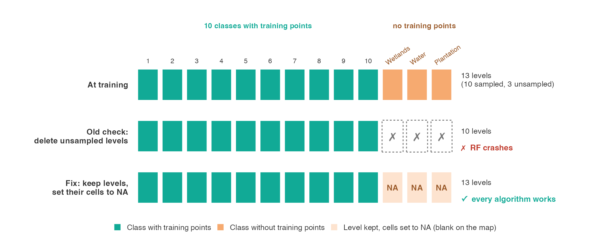

# Categorical layers in SDMs: many classes, few points, big areas

Author details: Xiang Zhao

Contact details: support\@ecocommons.org.au

Copyright statement: This script is the product of the EcoCommons platform. Please refer to the EcoCommons website for more details: <https://www.ecocommons.org.au/>

Updated date: 18 November 2026

# Short version

Categorical predictors such as vegetation type, land use or soil class are a known weak spot in species distribution models (SDMs), and the situation is worst when three things happen together: **many classes, few occurrence points, and a large study area**.

The usual answer is to **reduce the number of categories before modelling**, not to fix things at projection time. Masking classes the model never saw (described below) is a useful safety net, but it is not a modelling fix.

# What usually goes wrong

| Problem | Why it happens |
|:---|:---|
| **Too many parameters for the data** | A factor with *k* classes costs *k* − 1 parameters in a GLM or GAM. A common rule of thumb is about 10 points per parameter, so a 13-class vegetation layer with ~100 presences is already stretched. |
| **Empty or near-empty classes** | A class with 0–2 points has no reliable estimate, and predictions there are guesswork. In one recent quoll model, the Water, Wetlands and Plantation classes had no training points at all. |
| **Random forests favour many-level factors** | Random forests prefer variables with many possible split points, so a 13-class layer can look more important than it really is. The `randomForest` R package also has a hard limit of 53 levels per factor. |
| **Resampling to coarse cells** | When a categorical layer is resampled to 250 m or coarser with nearest-neighbour, each cell keeps a single class and the mix of classes within the cell is lost. |
| **Too few pseudo-absences** | With a pseudo-absence ratio of 1 (as many pseudo-absences as presences), rare classes often receive no points even though they exist in the study area. |

# What EcoCommons does to avoid model failure

The EcoCommons platform runs several automatic checks on categorical layers so that a model run does not crash or silently produce nonsense. These checks keep the run working, but they do not decide how many classes your layer *should* have. That choice is still up to you (see the next section).

1.  **Checks that the layer really is categorical.** When a layer is marked as categorical, EcoCommons inspects its cell values first. The run stops with a clear error if the layer contains non-integer values, or if it has more than 1,000 classes. Both usually mean continuous data has been labelled as categorical by mistake. Without this check, such a layer could create thousands of factor levels and run out of memory.
2.  **Resamples with nearest-neighbour.** When a categorical layer is brought to the model resolution, EcoCommons uses nearest-neighbour resampling, so every cell keeps a real class code instead of an averaged value that matches no class.
3.  **Stops early for algorithms that cannot use categories.** Bioclim, the Surface Range Envelope (SRE) and the geographic models (Circles, Convex Hull, Geographic Distance, Inverse Distance Weighted and Voronoi Hull) cannot handle categorical predictors. If one is included, the run stops at the start with a message saying so, rather than failing later.
4.  **Removes empty and one-cell classes in the training area.** After the layers are cropped to the training region, classes that no longer occur there are removed. A class that covers only a single cell is also removed, with a warning, because it can break the projection step.
5.  **Masks classes the model never saw when projecting.** For the biomod2 algorithms (GLM, GAM, RF, MARS, GBM, CTA, FDA and ANN), EcoCommons compares the classes in the projection layer with the classes present in the training data before projecting. From EC-R 1.4.12, cells of classes with no training points are set to NA in the projection layer (the class list itself is kept), and the run log lists the masked classes. These areas are left blank in the map rather than given an invented prediction. Without this step, the projection fails with an error, because the model cannot predict for a class it has never seen.

::: {.callout-note}
## Case study: a random forest run that crashed on unsampled vegetation classes

**The job.** A random forest (RF) model for the Spotted-tailed Quoll used one categorical layer, Broad Vegetation Groups at 250 m ("Broad veg group_categorical_250m"), plus five continuous soil and terrain layers.

-   The layer has 14 classes. Callitris woodland covered a single cell and was removed before modelling (check 4, with its own warning).
-   The other 13 classes went into the model, and `randomForest` recorded all 13 as the levels of the factor.
-   Only 10 of those classes had training points. Wetlands, Water and Plantation had none.
-   Before projecting, the old version of check 5 deleted every class the training points didn't use, leaving 10 levels. `randomForest` needs the same number of levels as at training. With 10 instead of 13, it stopped with *"Type of predictors in new data do not match that of the training data"*.

**What happens to the 13 classes**

{fig-alt="The 13 vegetation classes at three stages. At training, 10 classes have points and 3 do not. The old check deleted the 3 unsampled levels, leaving 10, and RF crashed. The fix keeps all 13 levels and sets the cells of the 3 unsampled classes to NA, and every algorithm works."}

**Why the deletion was there, and why simply keeping the levels fails.** We tested all nine biomod2 algorithms that go through this step (biomod2 4.2-2) on a synthetic 13-class raster with three unsampled classes:

| Algorithm | Old: delete levels | Keep levels, no masking | Fix: keep levels, NA cells |
|:---|:---:|:---:|:---:|
| RF | ✗ crashes | ✓ | ✓ |
| GLM | ✓ | ✗ "factor veg has new levels" | ✓ |
| GAM | ✓ | ✗ "number of items to replace" | ✓ |
| GBM, CTA, ANN, FDA, MARS | ✓ | ✓ | ✓ |

-   The deletion was originally added for GLM. Removing it outright would have traded the RF crash for GLM and GAM crashes.
-   The fix gives the same map GLM and GAM already produced (the three classes' cells are blank), and RF gets the 13 levels it expects.
-   MaxEnt, Bioclim and the geographic models don't go through this step.

**The change.** The helper now masks cells instead of deleting levels:

``` r
EC_mask_unused_levels <- function(raster, model_levels, name) {
  raster_labels <- terra::levels(raster)[[1]][[2]]
  used_labels <- unique(as.character(droplevels(model_levels)))
  levels_to_mask <- raster_labels[!raster_labels %in% used_labels]
  if (length(levels_to_mask) == 0) return(raster)
  message("In raster layer ", name, ", the following level(s) were not present ",
          "in the model data; their cells are set to NA for projection:\n",
          paste(levels_to_mask, collapse = ", "))
  terra::mask(raster, raster %in% levels_to_mask, maskvalues = TRUE)
}
```

**The modelling lesson.** Three of the 13 classes had no points at all, which is the "many classes, few points" problem this page is about. Merging classes or using more pseudo-absences (sections 1 and 3 of [What practitioners usually do](#what-practitioners-usually-do)) would have avoided the blank areas. For a ground-dwelling quoll, leaving open water blank is reasonable anyway.
:::

The last check is a safety net, not a modelling fix. If a large part of your map is blank, the categorical layer has too many classes for your data, and the approaches below are the real fix.

# What practitioners usually do

## 1. Merge classes into fewer, ecologically meaningful groups

Before modelling, collapse the original classes into a handful of groups that make sense for the species. For example, 13–30 vegetation classes can become 4–6 structural groups (forest, woodland, shrubland, grassland, cleared/modified), with rare classes folded into an "other" group.

This is the most common advice when training data are small: fewer levels means fewer parameters, fewer empty classes, and less inflated importance in random forests.

## 2. Convert to proportion-of-cover layers

Replace the single categorical layer with one continuous layer per class (or per merged group), such as "% eucalypt forest within 1 km" of each cell. This is standard practice in landscape-ecology SDMs because:

-   there is no level problem at all;
-   it handles mixed cells properly instead of picking one class;
-   it works at any resolution, so coarse resampling no longer throws information away;
-   every algorithm treats it like any other continuous predictor.

Combined with step 1, you usually only need a few of these layers.

## 3. Use more pseudo-absences or background points

Regression-type models (GLM, GAM, MaxEnt) typically use around **10,000 background points**. For random forests, the usual recommendation is equal numbers of presences and pseudo-absences, repeated several times, or down-sampling of the background (Barbet-Massin et al. 2012; Valavi et al. 2022).

More background points spread over the study area make it much more likely that every class is represented in the training data.

## 4. Mask unsupported classes in the output

At projection time, cells whose class was never seen in training can be masked out of the prediction. This is the categorical equivalent of what a MESS map or a clamping mask does for continuous predictors: don't report predictions where the model has no support.

This is honest, but it leaves holes in the map, which is why it should be a safety net rather than the main strategy. If many cells end up masked, steps 1–3 are the real fix.

## 5. Drop the layer if it adds little

With small data, a 13-class factor often costs more than it explains. Fit the model with and without the categorical layer and compare performance on held-out data; if the gain is small, leave it out or replace it with a continuous proxy.

# Suggested workflow

1.  Merge the categorical layer into 4–6 ecologically meaningful groups.
2.  Where resolution or mixed cells matter, convert those groups to proportion-of-cover layers.
3.  Use enough background points that every remaining group is represented.
4.  Keep the projection-time mask as a safety net for any class that still has no support.
5.  Check whether the layer improves the model at all; drop it if not.
